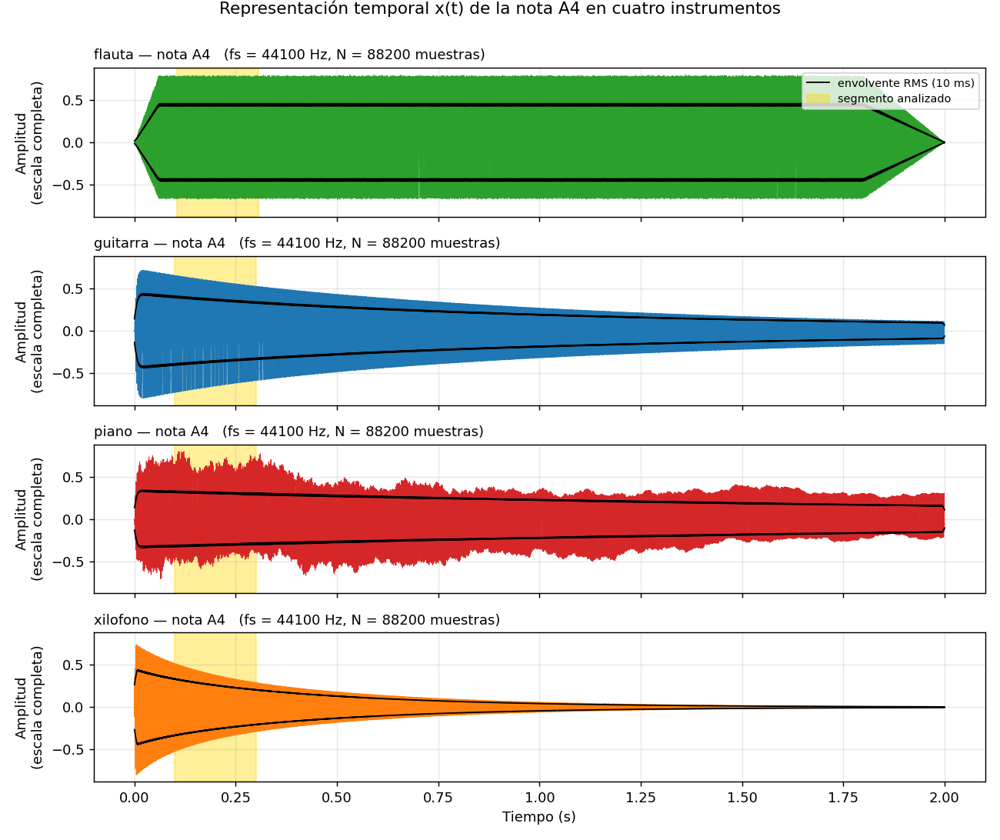
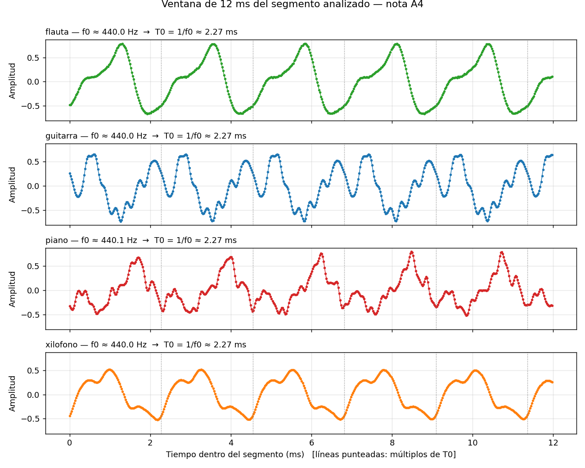
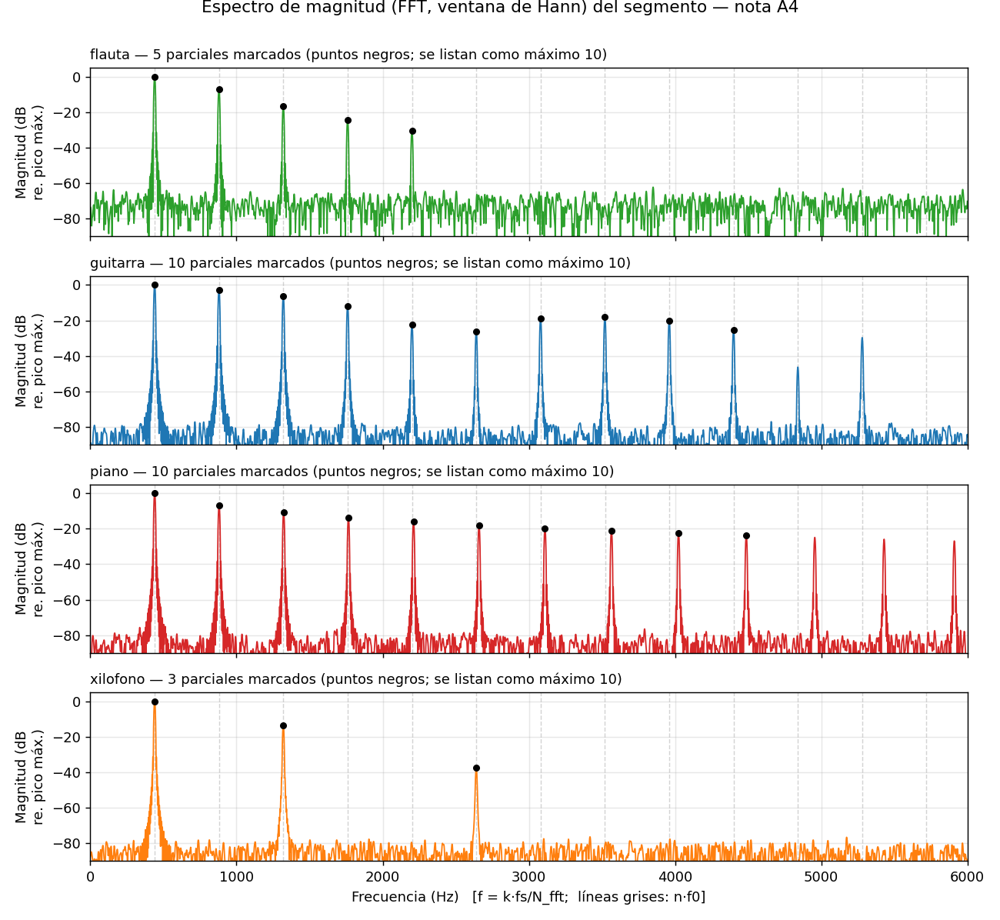
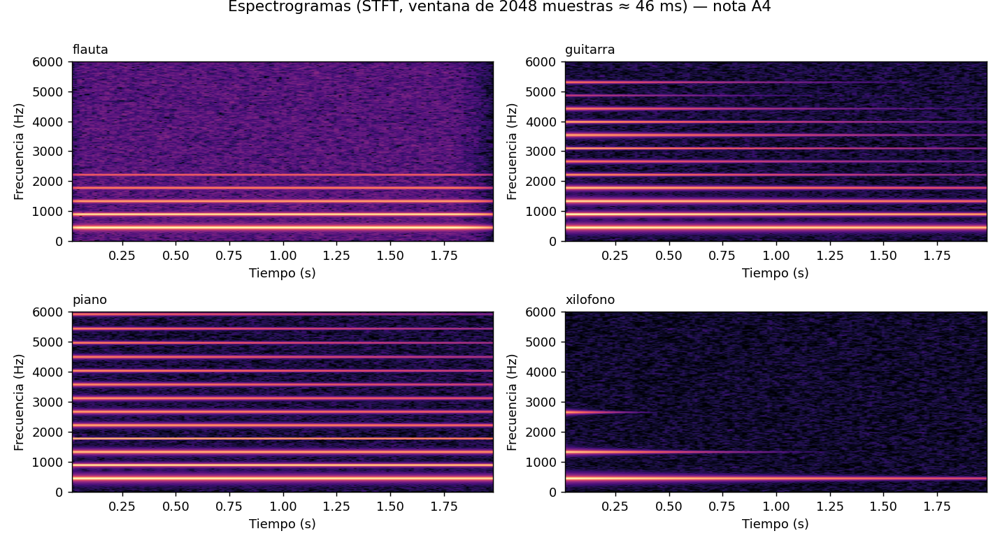
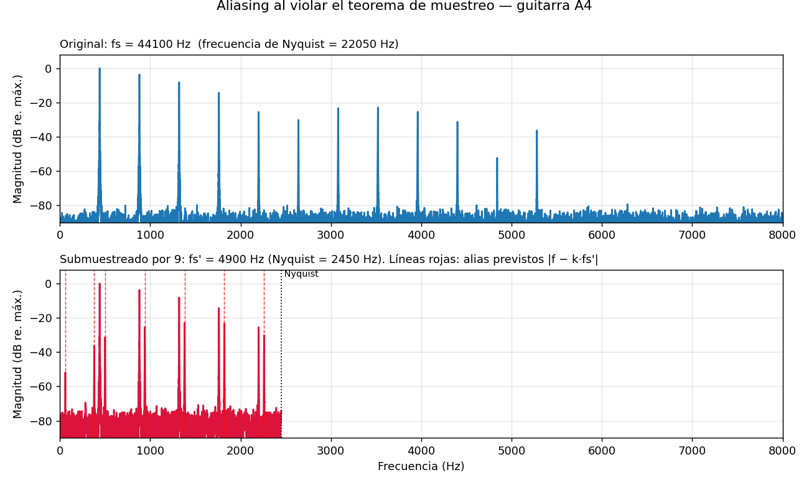
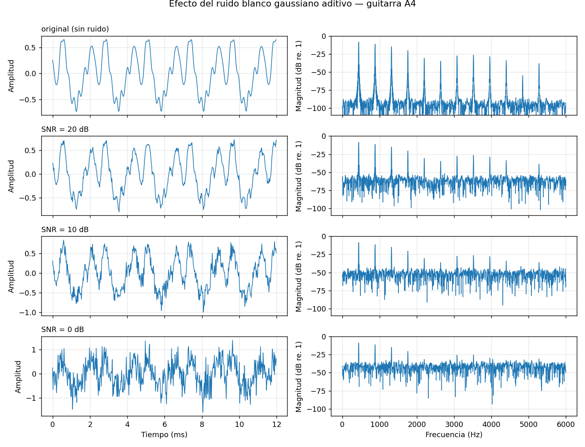
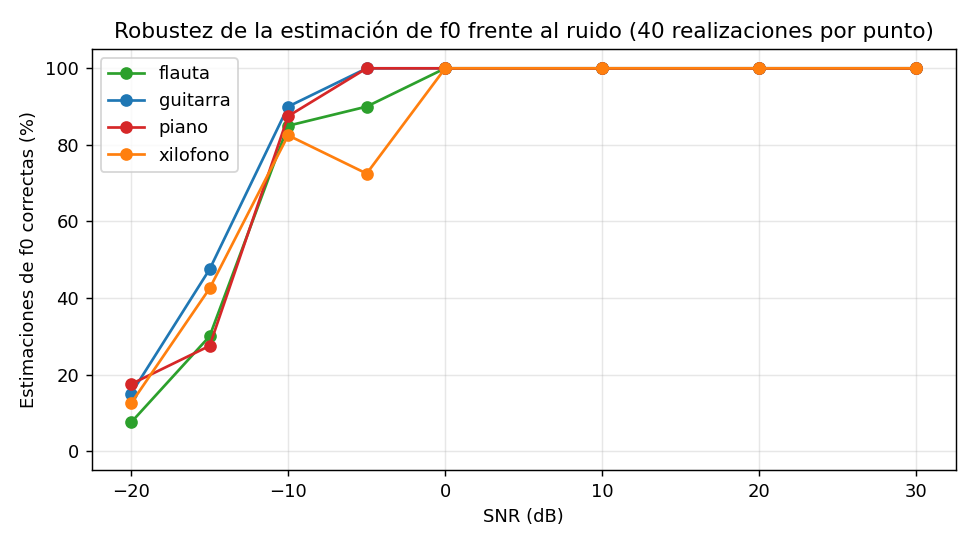

# Reconocimiento de instrumentos musicales mediante análisis espectral

**Teoría de Señales — Segunda entrega (implementación inicial)**

## 1. Integrante

| Nombre | Programa | Código | Usuario de GitHub |
|---|---|---|---|
| Juan David Chalarca Galvez | Ingeniería en Sistemas y Telecomunicaciones | 8202412521 | @JuandChala |

## 2. Descripción

**Fenómeno estudiado:** el sonido de una nota musical. Dos instrumentos que tocan la misma nota
comparten la frecuencia fundamental $f_0$, pero suenan distinto por su **timbre**: cuántos
armónicos tienen y con qué intensidad, qué tan rápido comienza la nota (ataque) y cómo se apaga.

**Objetivo del sistema:** a partir de grabaciones de audio, medir $f_0$, los armónicos, el
espectro y la evolución tiempo-frecuencia para encontrar **características que permitan
diferenciar instrumentos** (guitarra, flauta, piano y xilófono: cuerda pulsada, viento,
cuerda percutida y percusión de altura definida).

## 3. Estado actual

| Ya funciona ✅ | Falta por desarrollar ⏳ |
|---|---|
| Carga de WAV (8/16/24/32 bits, mono/estéreo, cualquier fs) y registro de $f_s$, $T_s$, $N$, bits | Grabar y analizar **audios reales** de los instrumentos (hoy se usan señales simuladas) |
| Generador reproducible de señales simuladas de 4 instrumentos | Filtrado de ruido (pasa-altas / pasa-banda) cuando se vea en clase |
| Caracterización temporal: mín., máx., media, RMS, potencia, energía, factor de cresta, cruces por cero, envolvente, tiempo de ataque y de decaimiento | Más características (rolloff, planitud espectral, MFCC) |
| Segmentación con criterio fijo (segmentos comparables) | Clasificador de instrumentos y métricas (exactitud, matriz de confusión) |
| Análisis frecuencial: FFT con ventana de Hann, $f_0$, parciales, centroide, espectrograma | Validación con más notas, más tomas y más instrumentos |
| Ruido blanco gaussiano con SNR controlada y experimento de robustez de $f_0$ | Interfaz / demostración final |
| Demostración de aliasing (muestreo) | |
| 10 pruebas automáticas | |

## 4. Datos o recursos

**En esta entrega la señal es simulada (generada computacionalmente), no grabada.**

* Carpeta `data/audio_sintetico/`: 8 archivos WAV (guitarra, flauta, piano y xilófono tocando
  **A4 y C5**), $f_s = 44\,100$ Hz, 16 bits, mono, 2.0 s.
* Se generan con `python -m src.sintesis` mediante **síntesis aditiva** (suma de sinusoides con
  amplitudes y decaimientos propios de cada instrumento). Los modelos y parámetros están en
  [`docs/modelo_sintesis.md`](docs/modelo_sintesis.md); se basan en la acústica de instrumentos
  (Fletcher & Rossing, 1998) y **no provienen de mediciones reales**.
* Consecuencia: las diferencias entre instrumentos que se observan abajo fueron *puestas por
  construcción*; sirven para validar que el análisis las detecta, no para afirmar que los
  instrumentos reales se comporten exactamente igual.
* Las grabaciones propias irán en `data/audio_real/` siguiendo
  [`docs/protocolo_grabacion.md`](docs/protocolo_grabacion.md); el código ya las soporta
  (`--audio-dir data/audio_real`).

Ver también [`data/README.md`](data/README.md).

## 5. Cómo ejecutar

**Requisitos:** Python 3.9 o superior (probado con 3.12), `numpy` y `matplotlib`.

```bash
# 1) Clonar y entrar a la carpeta
git clone https://github.com/JuandChala/proyecto-teoria-senales.git
cd proyecto-teoria-senales

# 2) (Recomendado) entorno virtual
python -m venv .venv
source .venv/bin/activate          # Windows: .venv\Scripts\activate

# 3) Instalar dependencias
pip install -r requirements.txt

# 4) Ejecutar la demostración principal (usa data/audio_sintetico)
python -m src.main
```

Si su editor solo tiene botón "Run", abra y ejecute `ejecutar_demo.py` (hace lo mismo).

La ejecución imprime la tabla de $f_s$/$T_s$/$N$ de cada señal, la comparación de timbre y deja
**7 figuras y 4 tablas CSV en `results/`**.

| Opción | Efecto |
|---|---|
| `--audio-dir data/audio_real` | analiza sus grabaciones en vez de las simuladas |
| `--salida results_real` | cambia la carpeta de resultados |
| `--nota A4` | nota usada para comparar instrumentos |
| `--interactivo` | pregunta por consola qué nota e instrumentos comparar |
| `--snr 20 10 0` | niveles de SNR de la figura de ruido |
| `--semilla 2026` | semilla del ruido (reproducibilidad) |

Otros comandos:

```bash
python -m src.sintesis                 # regenera las señales simuladas
pip install pytest && python -m pytest -q    # pruebas automáticas (o: python -m tests.test_basico)
```

## 6. Conceptos de Teoría de Señales utilizados

| Concepto | Dónde se aplica |
|---|---|
| Señal continua vs. discreta, muestreo, $T_s = 1/f_s$ | `audio_io.py` (registro de $f_s$, $T_s$, $N$); tabla de §7.1 |
| Teorema de Nyquist y **aliasing** | `graficas.graficar_aliasing`, figura 7 |
| Cuantización (16 bits) | `audio_io.leer_wav / escribir_wav`; [`docs/parametros_y_decisiones.md`](docs/parametros_y_decisiones.md) |
| Representación temporal $x[n]$, amplitud, mín./máx./media | `caracteristicas.caracteristicas_temporales`; figuras 1 y 2 |
| Energía, potencia y valor RMS | `caracteristicas.caracteristicas_temporales` |
| **Periodicidad**: periodo $T_0$ y frecuencia fundamental $f_0=1/T_0$ | `estimar_f0` (autocorrelación + FFT); figura 2 |
| Envolvente y señales no estacionarias | `segmentacion.envolvente_rms`, `parametros_envolvente` |
| Segmentación y ventaneo | `segmentacion.seleccionar_segmento`; ventana de Hann |
| **DFT/FFT**, resolución en frecuencia, fuga espectral, relleno con ceros | `caracteristicas.espectro_magnitud`; figura 3 |
| Armónicos / parciales, inarmonicidad, centroide espectral | `encontrar_parciales`, `centroide_espectral` |
| Análisis tiempo-frecuencia (STFT, espectrograma) | figura 4 |
| Ruido aditivo, **SNR** (dB), ruido blanco gaussiano | `ruido.py`; figuras 5 y 6 |
| Autocorrelación | `autocorrelacion_normalizada` |

## 7. Resultados actuales

Todos los resultados usan la nota **A4 (440 Hz) en los cuatro instrumentos**, para que las
diferencias sean de timbre y no de altura. Se reproducen con `python -m src.main`.

### 7.1 Señales cargadas (documentación de $f_s$)

Las 8 señales: $f_s = 44\,100$ Hz → $T_s = 1/f_s \approx 22.68\ \mu s$; $N = 88\,200$ muestras;
duración 2.00 s; 16 bits; mono. Tabla completa (incluye mín., máx., media, RMS, energía) en
[`results/metadatos_senales.csv`](results/metadatos_senales.csv).

### 7.2 Representación temporal



**Qué muestra.** La señal completa (2 s) de cada instrumento, su envolvente RMS (negro) y el
segmento que se analizará (amarillo, 0.2 s después del ataque).

**Qué observamos.**
* **Flauta:** el ataque es lento (≈ 49 ms) y luego la amplitud es **constante** hasta que baja
  al final: es un sonido sostenido. Su valor RMS es el mayor (0.43).
* **Guitarra:** ataque rápido (≈ 10 ms) y **decaimiento exponencial** suave; cae al 50 % de su
  máximo en ≈ 0.76 s.
* **Piano:** ataque rápido (≈ 8 ms) y decaimiento más lento (≈ 1.69 s hasta el 50 %). La forma de
  onda tiene **fluctuaciones de amplitud** (batidos) aunque la envolvente RMS es suave.
* **Xilófono:** ataque muy rápido (≈ 4.5 ms) y se apaga enseguida (50 % en ≈ 0.26 s); es la señal
  con mayor factor de cresta (5.8), es decir, picos grandes frente a su valor RMS.
* La media de las cuatro señales es ≈ 0: no hay componente continua.



**Qué muestra.** Un zoom de 12 ms. Las líneas punteadas marcan múltiplos del periodo
$T_0 = 1/f_0 = 2.27$ ms.

**Qué observamos.** Las cuatro señales son **periódicas con el mismo periodo** (misma nota), pero la
**forma de un periodo es distinta** en cada instrumento: eso es el timbre en el dominio del
tiempo. La flauta es la más cercana a una sinusoide (pocos armónicos); la guitarra tiene picos
adicionales dentro de cada periodo (más armónicos). En el piano la forma **no se repite exactamente**
de un periodo al siguiente (es *casi* periódica), consecuencia de que sus parciales no son
múltiplos exactos de $f_0$ (ver 7.3). El conteo de cruces por cero lo confirma: una sinusoide de
440 Hz cruza por cero ≈ 880 veces/s; la flauta tiene 892 (casi sinusoidal), mientras que la guitarra
tiene 1 302, el piano 1 228 y el xilófono 1 031 (los armónicos añaden cruces).

### 7.3 Análisis frecuencial



**Qué calculamos.** La FFT del segmento de 8 820 muestras (0.2 s) con ventana de Hann.
* **Eje horizontal:** frecuencia en Hz, $f[k] = k\,f_s/N_{FFT}$, desde 0 hasta $f_s/2$ (aquí se
  muestra hasta 6 kHz).
* **Eje vertical:** magnitud en dB respecto al pico mayor. Antes de pasar a dB, la magnitud se
  calibra para que un seno de amplitud $A$ dé un pico de altura $A$.
* **Resolución:** $f_s/N = 5$ Hz; el ancho del lóbulo principal de Hann es ≈ ±10 Hz. El relleno
  con ceros solo interpola, no aumenta la resolución.
* Líneas grises: rejilla armónica $n\cdot f_0$. Puntos negros: parciales detectados.

**Qué observamos** ($f_0$ medida = 440.00 Hz en flauta, guitarra y xilófono, y 440.09 Hz en el
piano; error < 0.4 cents):

| Instrumento | Parciales | Razón $f/f_0$ | Nivel relativo a $f_0$ | Centroide | Ataque | Tiempo al 50 % |
|---|---|---|---|---|---|---|
| Flauta | 5 | 1, 2, 3, 4, 5 | 0, −6.9, −16.5, −24.4, −30.5 dB; nada por encima | 1 222 Hz | 49 ms | 1.84 s |
| Guitarra | ≥ 10 | 1, 2, 3, … 10 | 0, −2.7, −6.4, −11.9, −22.4 … (irregular) | 1 404 Hz | 10 ms | 0.76 s |
| Piano | ≥ 10 | 1, 2.001, 3.005, … **10.196** | 0 … −23.8 dB (decrece suave) | 1 712 Hz | 8 ms | 1.69 s |
| Xilófono | 3 | 1, **3.0, 6.0** | 0, −13.5, −37.5 dB | 787 Hz | 4.5 ms | 0.26 s |

* La **flauta** tiene pocos armónicos que decaen rápido: timbre "puro".
* La **guitarra** tiene muchos armónicos con un patrón irregular de intensidades (algunos
  armónicos medios quedan más débiles que los siguientes), lo que da un timbre más brillante.
* El **piano** tiene el espectro más rico y el mayor centroide (1 712 Hz). Sus parciales están
  **"estirados"**: el décimo cae en 4 487 Hz, no en 4 400 Hz (se ve en la figura cómo los picos
  se alejan de las líneas grises). Es la señal de la inarmonicidad.
* El **xilófono** solo tiene parciales en 1×, 3× y 6× $f_0$ (faltan los pares) y el menor centroide.
* Con solo tres números —tiempo de ataque, tiempo al 50 % y centroide— más la estructura de
  parciales, los cuatro instrumentos quedan **separados** en este conjunto.



**Qué muestra.** El espectrograma (STFT, ventana de 2048 muestras ≈ 46 ms, resolución ≈ 21.5 Hz):
frecuencia en el eje vertical, tiempo en el horizontal y el brillo indica la magnitud.
**Qué observamos.** Cada línea horizontal es un parcial. En la flauta las líneas se mantienen
constantes; en la guitarra los parciales agudos desaparecen antes que los graves; en el xilófono el
parcial de 2 640 Hz se apaga hacia 0.4 s y el de 1 320 Hz hacia 1.2 s, mientras que la fundamental
persiste. La FFT del segmento no puede mostrar esta evolución en el tiempo.

### 7.4 Muestreo: aliasing



**Qué muestra.** Se submuestrea la guitarra A4 por un factor 9 **sin filtro anti-aliasing**
($f_s' = 4\,900$ Hz, Nyquist = 2 450 Hz). Los armónicos 6 a 12 (2 640–5 280 Hz) superan el
Nyquist y reaparecen en frecuencias falsas $|f - f_s'|$: 2 260, 1 820, 1 380, 940, 500, 60 y
380 Hz. Las líneas rojas son estos alias **previstos por la teoría** y coinciden con los picos
nuevos del espectro, que no existen en la señal original. Se eligió el factor 9 (y no 10) porque
con $f_s' = 10 f_0$ los alias caerían sobre otros armónicos y no se distinguirían.

**Justificación de $f_s = 44\,100$ Hz:** los parciales de estas señales llegan a ≈ 6 kHz (bastaría
$f_s>12$ kHz); 44.1 kHz es el estándar de audio y deja un margen amplio frente a Nyquist
(22 050 Hz).

### 7.5 Ruido

Se modela la degradación como ruido blanco gaussiano aditivo, $y[n]=x[n]+w[n]$, con
$\sigma^2 = P_x/10^{SNR/10}$ y semilla 2026. SNR pedida → SNR medida: 20 → 19.94 dB,
10 → 10.04 dB, 0 → −0.08 dB.



**Qué observamos.**
* **En el tiempo:** con 20 dB la forma de onda apenas se deforma; con 10 dB se ve irregular pero la
  periodicidad sigue visible; con 0 dB (ruido con la misma potencia que la señal) cuesta
  distinguir la forma de un periodo.
* **En frecuencia:** el ruido blanco eleva un **piso de ruido** plano que sube ≈ 10 dB por cada
  10 dB que baja la SNR. Los armónicos débiles (los agudos) quedan por debajo del piso y
  "desaparecen"; con 0 dB solo se distinguen los primeros armónicos. Esto anticipa (hipótesis a
  verificar en la siguiente entrega) que las características basadas en armónicos débiles serán las más
  sensibles al ruido.



**Qué muestra.** Porcentaje de veces (de 40 realizaciones de ruido) en que la $f_0$ estimada
queda a menos de 50 cents de la real, según la SNR.
**Qué observamos.** La estimación de $f_0$ es **mucho más robusta que la apariencia de la
forma de onda**: acierta el 100 % de las veces hasta 0 dB; a −5 dB algunos instrumentos empiezan
a fallar (xilófono 72.5 %, flauta 90 %) y entre −15 y −20 dB colapsa (7.5 %–47.5 % de aciertos).
Esto ocurre porque el segmento de 8 820
muestras concentra la energía periódica en pocos coeficientes de la FFT, mientras que el ruido blanco
se reparte en todos. Los puntos no monótonos (p. ej. xilófono a −5 dB) se deben al número finito de
realizaciones y a errores de octava ocasionales. Los datos están en
[`results/robustez_ruido.csv`](results/robustez_ruido.csv).

### 7.6 Primera etapa de procesamiento

Segmentación con **criterio idéntico** para todos los instrumentos: envolvente RMS (10 ms) →
inicio de la nota al 10 % del máximo → se descartan 0.10 s (transitorio de ataque) → ventana de
0.20 s (8 820 muestras). Así los espectros se comparan en la misma fase de la nota. Detalle y
justificación de cada parámetro: [`docs/parametros_y_decisiones.md`](docs/parametros_y_decisiones.md).

## 8. Referencias

1. Oppenheim, A. V., & Schafer, R. W. (2010). *Discrete-Time Signal Processing* (3.ª ed.). Pearson.
2. Fletcher, N. H., & Rossing, T. D. (1998). *The Physics of Musical Instruments* (2.ª ed.). Springer.
3. Harris, F. J. (1978). On the use of windows for harmonic analysis with the discrete Fourier transform. *Proceedings of the IEEE, 66*(1), 51–83.
4. Müller, M. (2015). *Fundamentals of Music Processing: Audio, Analysis, Algorithms, Applications*. Springer.
5. Smith, J. O. (2007). *Mathematics of the Discrete Fourier Transform (DFT) with Audio Applications* (2.ª ed.). W3K Publishing. https://ccrma.stanford.edu/~jos/mdft/
6. Eronen, A., & Klapuri, A. (2000). Musical instrument recognition using cepstral coefficients and temporal features. *Proc. IEEE ICASSP*. *(Antecedente de las características que se planean para la entrega final.)*
7. Engel, J. et al. (2017). Neural audio synthesis of musical notes with WaveNet autoencoders. *Proc. ICML*. *(Base de datos NSynth, opción de datos reales para etapas posteriores.)*

---

## Estructura del repositorio

```
proyecto-teoria-senales/
├── README.md
├── requirements.txt
├── .gitignore
├── ejecutar_demo.py        # atajo para ejecutar la demostración
├── src/
│   ├── audio_io.py         # lectura/escritura de WAV, metadatos, notas
│   ├── sintesis.py         # generador de señales simuladas
│   ├── segmentacion.py     # envolvente, inicio, segmento comparable, normalización
│   ├── caracteristicas.py  # características temporales y frecuenciales
│   ├── ruido.py            # ruido aditivo con SNR controlada
│   ├── graficas.py         # figuras
│   └── main.py             # demostración principal
├── tests/test_basico.py    # pruebas con señales de respuesta conocida
├── data/                   # audio_sintetico/ y audio_real/
├── results/                # figuras PNG y tablas CSV
└── docs/                   # modelo de síntesis, protocolo de grabación, decisiones
```

*El proyecto se desarrolla con scripts (no notebooks) para que el código sea modular y reproducible.*